# 1. Preparacion del entorno
Crea un directorio personal en HDFS bajo /user con tu nombre de usuario y dentro de él un directorio llamado proyecto_datos.

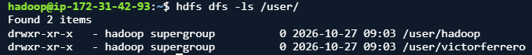

# 2. Carga de datasets
Descarga el dataset Automotive Price Prediction Dataset que puedes obtener desde Kaggle y que contiene un dataset sintético con información y precio de 1000000 de vehículos de segunda mano
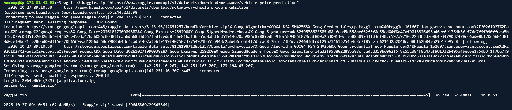
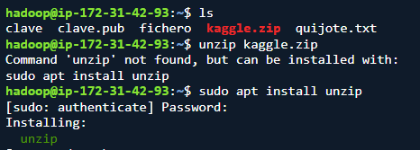
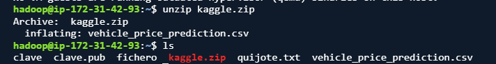
Desde tu sistema local, sube al directorio proyecto_datos el dataset que has descargado.
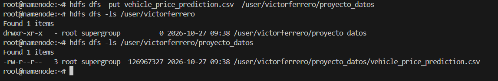
# 3. Exploracion de datos
Visualiza el contenido del archivo directamente en HDFS.
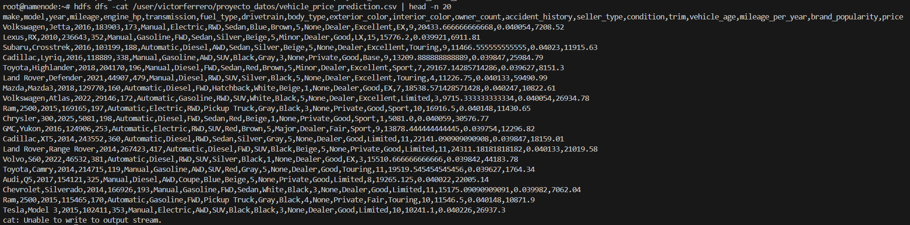
Obtén el número de líneas del dataset.
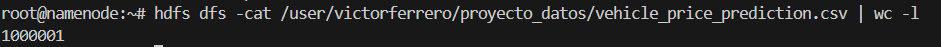
# 4. Organización de datos
Crea un subdirectorio procesados y otro backup dentro de tu carpeta de proyecto.
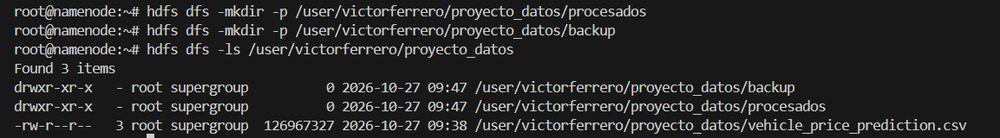
Copia el archivo original a backup.
Mueve el archivo original de proyecto_datos a procesados.
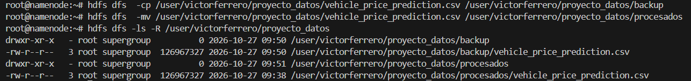
# 5. Colaboración en el equipo
Crea un directorio compartido bajo /compartido (si no existe) y copia allí tu dataset para que otros puedan acceder.
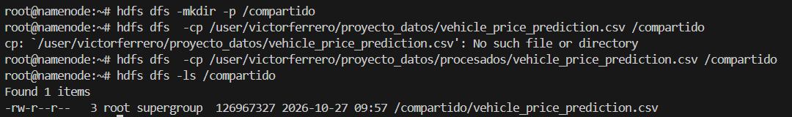
# 6. Recuperación de datos
Descarga a tu sistema local el archivo que está en el directorio procesados.
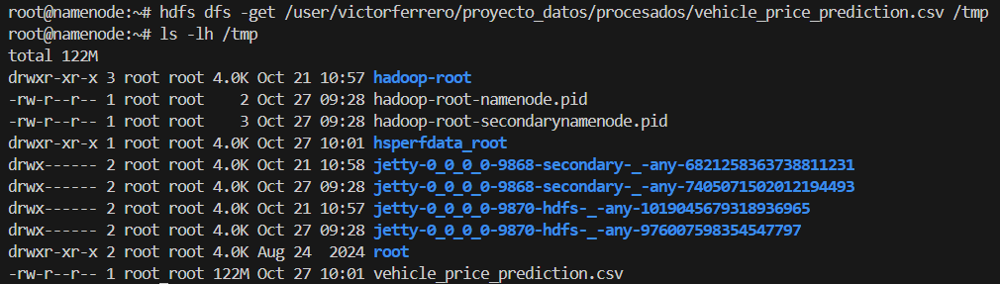
# 7. Control de accesos
Verifica los permisos de tus archivos.
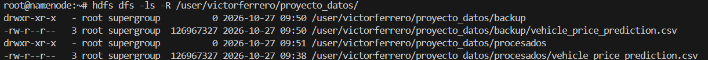
Cambia los permisos de un archivo de backup para que solo tú tengas acceso de lectura y escritura.
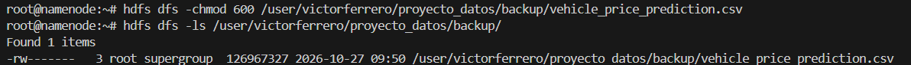
# 8. Mantenimiento
Elimina un archivo temporal que hayas subido por error a tu espacio en HDFS
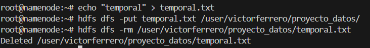